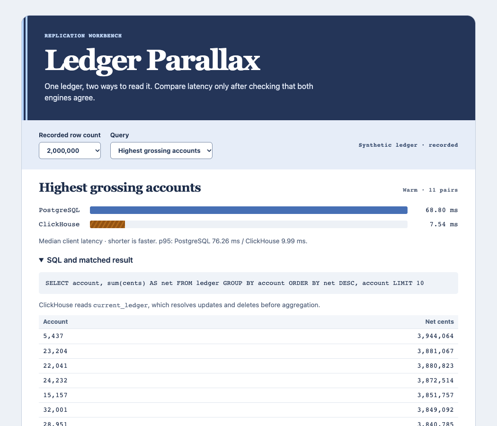

# Ledger Parallax · Postgres → ClickHouse replication workbench

When is it worth reading from the analytical replica, and is its answer current? This React/TypeScript console runs the same three queries on a writable Postgres ledger and a real ClickHouse replica. It separates recorded performance from live correctness: pause replication and the two live result tables can disagree.

**Measured on 2 million synthetic orders:** ranking accounts took **68.80 ms on Postgres vs 7.54 ms on ClickHouse** (warm client medians). Looking up one order reversed the result: **0.234 ms vs 1.636 ms**. At 10,000 rows Postgres won all three comparisons in this run. These are local observations, not engine-wide speed claims.



## Run the full stack with Docker Compose

From this directory, with Docker Compose and free loopback ports 55438, 58138 and 58238. No credentials, external API calls or cloud resources. First build downloads public images and dependencies.


```sh
docker compose build console
docker compose up -d --wait postgres clickhouse
# Seed a FRESH lab. The benchmark itself consumes WAL; do not start the worker yet.
docker compose run --rm --no-deps console python -m ledger.bench \
  --sizes 10000 --runs 3 --output /tmp/demo.json
docker compose --profile console up -d --wait
```

Open **http://127.0.0.1:58238**. The dropdown browses the **checked-in receipt**, not the current database size. **Compare live databases** queries the running 10k-row source and replica. The quick-start run's temporary JSON disappears with its container. To seed the full 2M-row experiment instead, omit `--sizes 10000 --runs 3` on a fresh lab. On later startups skip the seed command; volumes persist. `docker compose --profile console stop` stops this stack without erasing data.

**Save a new measurement:** with the database services running on fresh volumes, worker off, use Python 3.11+ and [uv](https://docs.astral.sh/uv/):

```sh
uv sync --locked
uv run --locked --offline python -m ledger.bench --output artifacts/latest.json
(cd console && npm ci && npm run build)
uv run --locked --offline python -m ledger.serve --report artifacts/latest.json --port 58240
```

This last server also works with the databases stopped for browsing the stored receipt; live comparisons return an error. To keep consuming changes without the container worker, run `uv run python -m ledger.replicate --watch` in another terminal. The benchmark refuses a nonempty source. To repeat without erasing an older run, stop its project, then start new database volumes with `docker compose -p fresh-ledger up -d --wait postgres clickhouse`. Fixed ports mean only one such database pair can run on the host at a time.

## Results: synthetic data, real engines

[Raw receipt](evidence/run.json): 19 Nov 2026, 09:11:38–09:12:07 UTC, Apple M4, ARM64 Docker Desktop VM (10 CPUs, 8,321,515,520 bytes RAM), Postgres 16.9 and ClickHouse 25.8.4.13. Both databases were in Compose; the benchmark client was on the host. Background activity was not isolated. The dataset is generated by SQL, not a sample of real orders.

| Visible rows in each engine | Top 10 accounts, PG / CH p50 ms | Days 0–6 grouped, PG / CH p50 ms | Order 42, PG / CH p50 ms | PG / CH MiB |
|---:|---:|---:|---:|---:|
| 10,000 | 2.263 / 3.365 | 1.038 / 2.627 | 0.373 / 2.604 | 0.69 / 0.16 |
| 250,000 | 22.350 / 4.874 | 5.489 / 3.163 | 0.304 / 1.840 | 15.95 / 3.83 |
| 2,000,000 | 68.802 / 7.541 | 20.354 / 3.996 | 0.234 / 1.636 | 127.36 / 30.60 |

- **Latency:** one discarded warmup pair then 11 sequential measured pairs per query/size, alternating engine order. Each pair's ordered answers had to match. Timers include client I/O and result decoding; Postgres reused a libpq connection while ClickHouse opened an HTTP request per query. Small-query deltas include connection overhead. ClickHouse result cache off, max 3 query threads; PG permits two parallel workers per gather. OS caches warm; no artificial cold starts. p95 is nearest-rank and with 11 samples equals the maximum, not a stable tail estimate. The receipt includes every sample.
- **Storage:** Postgres `pg_total_relation_size('ledger')` includes the primary-key index; ClickHouse sums active `system.parts.bytes_on_disk` for the versioned table. Both are point-in-time physical measurements. Neither includes WAL, inactive parts, logs, backups, or complete container volumes. The narrow integers, monotonically increasing IDs, repetitive day field and compressibility matter. No tuning contest, concurrency benchmark or production sizing model.
- **Parity:** at each size, counts matched and SHA-256 digests matched over each engine's **complete visible table**, all four columns serialized as integer TSV ordered by primary key. At 2M: `ad50b1aa5787df170406dbdfae4673fbb0c26e9877866df11600f2b81a6533d7`. Integer cents avoid rounding differences; explicit secondary ordering breaks ties.
- **Lag:** the mutation probe updated 100 → 115 → 125 cents in one transaction. With the consumer paused for 250 ms, the source read 125 and the replica still read 100. Observed update visibility by **274.015 ms** after commit; delete visibility by **10.800 ms**. The last growth stage had 70 source transactions of up to 25k inserts; observed lag spanned **112.697–386.691 ms**. Load batches were drained immediately after commit. This is **not sustained throughput** or the latency distribution of the 500 ms polling worker. Times compare Postgres's commit clock with the client's clock after synchronous sink success; clock skew and observation overhead apply.

## Why a replay doesn't resurrect a deletion

1. An empty dedicated source starts a `pgoutput` logical slot and a publication for one table. No trigger or application dual-write. The consumer peeks through complete transactions; v1 relation messages must describe the expected key, order, types and column names.
2. A ClickHouse `ReplacingMergeTree(version) ORDER BY id` stores every insert/update and a tombstone for a delete. A key move emits a tombstone for the old ID plus the new row. The version encodes the commit LSN and in-transaction change ordinal; the same committed input produces the same version and payload on retry.
3. After synchronous sink success the consumer advances the slot through the last decoded commit. A failure between insert and acknowledgement may redeliver physical rows. The `current_ledger` view uses `FINAL` and excludes deleted winners; it does not wait for background merges. This provides **at-least-once delivery with idempotent current reads**, not exactly-once transport. Cooperating consumers use a session advisory lock.

The slot retains WAL during an outage; the lab caps retained slot WAL at 4 GiB (enforced at checkpoints). An invalidated slot or lost sink needs a fresh bootstrap. There is no existing-table snapshot, DDL/TRUNCATE support, schema migration, cross-system snapshot or multi-table transaction guarantee. Only the one all-int4 relation is supported; one large transaction must fit in memory. Tombstones are retained. Services have local demo passwords, loopback port bindings and no production authentication. The HTTP API exposes fixed queries, not arbitrary SQL. See [design](DESIGN.md), [Postgres logical decoding functions](https://www.postgresql.org/docs/16/functions-admin.html#FUNCTIONS-REPLICATION), and [ClickHouse replacement semantics](https://clickhouse.com/docs/engines/table-engines/mergetree-family/replacingmergetree).

## Verify

```sh
# Once dependencies are cached; no Docker required for this suite.
uv sync --locked
uv run --locked --offline pytest -q

# With both databases running and the continuous worker stopped:
docker compose stop worker
LAB_INTEGRATION=1 uv run --locked --offline pytest -q

# Node 22+; seed at least 42 rows first, e.g. with the quick start.
cd console && npm ci && npm run build
npx playwright install chromium   # one-time browser download
npm test                         # or CHROME_CHANNEL=chrome npm test with installed Chrome
```

Observed locally: **12 offline Python checks passed**, 3 database cases skipped without the opt-in; **15/15** with real databases. Three browser journeys passed against the production UI in headless Chrome: keyboard scale selection + live read, failed read + retry, and missing receipt + recovery. The error journeys intercept HTTP failures; successful live reads use both real engines. Also exercised actual replica disagreement and recovery with the packaged worker stopped and restarted. CI configuration runs on a small synthetic dataset; no hosted CI execution claimed.

## Two-minute walkthrough

**0:00–0:30 — Pick a read path.** Open the console, select 2M rows and compare the account ranking with the primary-key lookup. Point to both reversals: larger scans favor ClickHouse here; one indexed lookup favors Postgres. The historical scale selector never resizes a running database.

**0:30–1:00 — Check that speed didn't change the answer.** Expand SQL and result rows. Show the whole-table digest, the physical byte scopes, then the deliberately paused update and delete probe. Open the raw receipt for the 11 samples; don't present the largest sample as an SLO.

**1:00–1:40 — Make it stale.** On this disposable lab, pause the worker and insert a new high-value account. Choose **Highest grossing accounts → Compare live databases**. Only PostgreSQL has the new leader. Restart and compare again; both now return the same top row.

```sh
docker compose stop worker
docker compose exec -T postgres psql -U lab -d lab -c 'INSERT INTO ledger VALUES (-40,999999,0,2000000000)'
# Inspect the disagreement in the UI, then:
docker compose start worker
```

**1:40–2:00 — Clean up and explain replay.** Delete the demo row, compare again after a poll and show the previous leader. The tombstone beats older versions; replay before acknowledgement cannot bring the deleted order back.

```sh
docker compose exec -T postgres psql -U lab -d lab -c 'DELETE FROM ledger WHERE id=-40 AND account=999999'
```

MIT licensed. All orders, mutations and workloads are original and synthetic. No paid API spend.
